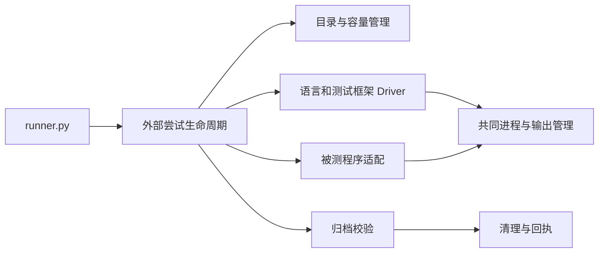

# 原生 SWE 临时文件管控规划（Python 测试系统）

日期：2026-09-15。状态：实现基线已落地。本文记录 Python SWE 测试系统的资源生命周期设计；对应模块位于 `scripts/swe_test_runner/`。Core-96 双平台评测于 2026-09-24 完成 192 项结算，逐次结果、原始证据和资源回执保存在本地 testbed，不纳入 Git。

目标：构建可覆盖不同仓库、语言和测试框架的外部测试系统，管住资源产生与回收，并为后续 AgentGo 架构优化保留稳定回归基线。唯一公开入口继续是 `scripts/swe_test_runner/runner.py`。用户已授权实施后重新验收；当前先完成离线与小规模真实仓库资格验证，再恢复全量真实模型测试。

题库范围与执行边界见 [Core-96 设计记录](swe-core96-native-expansion.md)。历史存储审计和逐次清理回执保存在本地运行目录，不纳入 Git。

## 1. 本轮边界

本轮改造仅涉及 Python Runner、测试资源配置、Python 回归测试和对应文档。AgentGo 作为被测程序，通过已有启动参数、环境变量、现有 API 和产物接入。

- 不要求新增 AgentGo 接口，不修改 Go 工作区复制、内部进程管理、Graph 或 L3 架构。
- AgentGo 内部产生的文件作为该次执行的实际资源占用进行统计；其增长是观察值，可以触发外部资源限制，但测试系统不干预内部目录结构来优化成绩。
- 现有 AgentGo 运行审计保留为被测程序适配逻辑。通用资源管理不依赖某个 Graph schema、候选目录名或节点状态字段。
- 工作树内已有的 Go 改动不属于本轮，不回滚、不混入本轮提交。
- 后续评测使用新的冻结尝试；历史成绩不覆盖、不重算，也不在本方案文档中保存逐次报告。

### 1.1 能提供的保证

Python 可以统一临时目录、限制自身写入的输出、监测整体占用、管理自有进程、校验归档并安全清理。

对第三方程序直接写盘，目录监测存在采样延迟，属于“监测并取消”，不是内核硬配额。被测程序忽略环境变量、脱离进程管理或通过外部服务写盘时，要明确记录能力边界；无法确认停止的现场保留，不能假称已经清干净。

需要严格目录/卷配额时，接入宿主已经提供的系统能力，并记录实际能力；这不成为修改被测程序的理由。

## 2. 采用共同生命周期，统一现有执行路径

当前 `runner.py`、`native_go.py`、`native_drivers.py` 各自有进程和输出处理；`native_harness.py` 又单独准备环境、复用工作树及复制日志。首先收敛这些路径。



拟新增模块均位于 `scripts/swe_test_runner/`，以职责组织，不建立另一套命令入口：

| 模块 | 职责 |
|---|---|
| `storage.py` | 私有目录、资源登记、空间测量、容量策略、缓存租约 |
| `storage_inventory.py` | 独立只读盘点进程、身份与截止时间，避免 Python GIL 竞争 |
| `processes.py` | 共同 Popen 启动、环境传递、输出收集、取消与退出核对；平台细节可拆文件 |
| `artifacts.py` | 归档清单、压缩、校验、引用映射和恢复检查 |
| `cleanup.py` | 删除计划、归属与活动状态复核、幂等执行、回执 |
| `lifecycle.py` | 将准备、运行、判题、留证、清理串成一致流程 |

既有 Driver 只提供上游检出、环境安装、测试命令、输入身份和报告解析，不再各自决定临时目录或终止流程。被测程序适配负责已有的启动、任务提交、观察与结果采集；首版复用 AgentGo 当前实现，不开发通用插件 SDK。

## 3. 每次执行一个独立目录，按用途登记资源

### 3.1 目录布局

```text
<testbed>/
  storage-root.json
  w/<attempt-prefix>/                     实际工作树，避免原生工具路径过长
  t/<attempt-prefix>/<phase-number>/       实际 scratch，满足 socket 路径约束
  cache/                                  Runner 自有共享缓存
  locks/
  batches/<batch_id>/
    batch.json                            冻结配置、题库及被测二进制身份
    attempts/<suite>/<task>/<attempt_id>/
      attempt.json
      resources.jsonl
      # attempt.json 显式关联上述实际 worktree/scratch 路径
      commands/<command_id>/               一份原始 stdout/stderr
      reports/                            基线、判题、诊断与资源报告
    summary.json
  archives/<batch_id>/<attempt_id>/
  cleanup/<plan_id>/
```

这是用途和所有权布局，不要求把所有依赖物理搬出项目。Node 的 `worktree/node_modules`、Flask 的 `.venv`、Native 的 `.swe-build/venv` 等可保留原有位置，由资源表登记用途、所有者和清理条件。不要通过改变包解析或导入路径来达到表面上的目录统一。

同题重跑产生新 `attempt_id`；外部尝试 ID 与 AgentGo 内部 Attempt 分开记录。验题与模型运行共用这套布局，但成绩分别记账。禁止在未留证时覆盖旧工作树或旧结果。

### 3.2 资源登记

每项资源记录：资源 ID、批次/题目/尝试/阶段、规范路径、用途、owned/shared/borrowed 类型、状态、保留理由和关联进程。

- owned：本次独占的工作树、scratch、输出等，满足条件后回收。
- shared：Runner 自有的下载或编译缓存，持有使用锁，按独立预算淘汰。
- borrowed：明确借用的外部上游仓库、工具链或缓存，清理器不删除。

分配前记录意图，成功后记录资源身份；删除前记录计划，执行后逐项确认。根身份和资源表保持在被删除的工作树之外。资源记录只描述测试资源，不成为第二套产品状态机。

## 4. 从产生源头控制临时文件

### 4.1 启动前固定阶段环境

所有准备、安装、编译、资格验证、被测程序启动和正式判题都通过共同环境构造器：

- `TEMP`、`TMP`、`TMPDIR` 指向本阶段 scratch；Go 的 `GOTMPDIR` 显式绑定阶段临时目录。
- 各语言下载缓存使用 Runner 自有路径或安装器参数；不修改用户全局配置。
- 构建输出按实际源码根配置。CMake 缓存不跨源码绝对路径搬运；Cargo 缓存键包含平台、工具链和构建选项。
- Runner 自己创建临时文件时显式传 `dir`，避免依赖已经缓存的默认临时目录。
- 对上游测试写死的额外路径，由 Driver 声明和登记；不能把设置 TMP 当成已经拦住所有外部写入。
- provider 凭据仅进入需要调用模型的被测程序环境；普通安装、编译和测试子进程不继承这些凭据，日志不打印完整环境。

环境变量需要在创建子进程之前固定；不要在并发任务之间反复修改全局 `os.environ`。[Python tempfile 文档](https://docs.python.org/3.12/library/tempfile.html)

### 4.2 环境与缓存有效性

改造 `prepared.json` 的复用条件：平台、工具链、依赖锁文件、环境路径、安装完成状态均匹配，且关键文件实际存在。清理依赖时同步失效对应记录；安装半途失败不能发布 ready 标记。

下载缓存与已安装环境区分管理：

- 下载缓存可跨题复用，但有容量预算和锁。
- 对绑定源码路径的已安装环境，优先按尝试独占，避免错误复用。
- 默认不使用可写共享依赖副本，以免一个题目影响另一个题目。
- 不因为缓存不足偷偷切换工具链、依赖版本或测试范围。

### 4.3 日志单次保存和限额

目前 `execute_tests` 会逐阶段复制此前所有 `.swe-build` 命令文件。改为：

1. 每个命令生成不可变 `command_id`，原始 stdout/stderr 只写一份。
2. 阶段报告只保存本阶段 command refs，避免 clean/red/green 重复复制。
3. 输出流式写入，解析器使用文件或流；不再默认将全部日志重新 `read_bytes()` 装入内存。
4. 写入前累计字节数，达到单命令或单尝试限额时取消执行，保存已有前缀并标明输出不完整。
5. 不完整输出不能被解析为有效通过；日志限额产生独立的资源失败。

原始日志封存后可以压缩。被测程序自行写出的内部日志由工作树总量监测，不宣称 Python 输出管道可以限制这些文件。

## 5. 加入容量预算和准入控制

### 5.1 策略

新增不含模型凭据的存储策略，冻结到每批记录：

| 策略 | 作用 |
|---|---|
| 最低磁盘余量 | 为用户其他工作和安全退出保留空间 |
| 单次尝试、整批在途数据上限 | 控制工作树、scratch、被测程序产物的增长 |
| 自有缓存容量上限 | 防止缓存长期无限积累 |
| 单命令和整题日志上限 | 限制 Runner 直接收集的输出 |
| 归档与退出预留 | 防止清理时反而没有留证空间 |
| 历史归档总量上限 | 包含已完成 ZIP、manifest 和失败 partial；满额后停止准入，保留历史证据 |
| 活动尝试数、编译并发数 | 控制同时增长的目录数量 |
| 采样间隔和样本最大年龄 | 避免用过期空间数据启动新任务 |

首版默认一题在途，先用代表性仓库校准峰值再提高并发。容量值由明确的策略文件提供，报告显示实际生效值；全量 Core-96 不能在缺少容量策略时直接启动。

同一存储卷采用共同预算锁，准入时预留预计后续增长。当前 free 已经扣除了现有文件，不能重复扣减。失败后保留的现场继续计入占用，不因任务状态结束而消失。

### 5.2 监测动作

启动前、阶段切换前和运行中检查所在卷；低频盘点目录总量，高频读取卷余量，避免为了监测频繁递归扫描整盘。

完整盘点由独立 Python 解释器执行，主进程中的线程只等待结果。使用基础解释器及隔离/无 site 启动，避免虚拟环境重定向器和用户启动代码；不继承模型凭据。记录盘点进程身份，截止时间到达后终止并等待。结束、归档和离线清理均核对该只读进程已退出。受控负载实验和实际模型负载都用于验收，不用空闲时盘点速度代替运行时能力。

- 接近下限：停止新任务和安装/编译阶段准入。
- 超过尝试或日志预算：取消相应执行，保存资源失败与已捕获证据。
- 无法确认进程已停止：保留现场并阻止依赖其清理结果的新任务。
- 归档也需要空间预算，不能临时复制整份现场后才发现磁盘不足。

状态使用独立原因，例如 `storage_budget_exceeded`、`disk_free_below_floor`、`output_limit_exceeded`、`process_quiescence_unknown`。它们不能算成“模型未修好代码”，也不能作为测试通过。

### 5.3 原生平台差异

Windows、macOS、Linux 使用各自真实运行环境。WSL 既检查 guest 空间，也检查 VHDX 所在宿主卷；guest 显示的可用容量不能代替宿主余量。[Microsoft WSL 磁盘说明](https://learn.microsoft.com/en-us/windows/wsl/disk-space)

首版由同一批次调度器串行调度共享宿主盘的运行。若后续开放 Windows/WSL 同宿主并发，必须有共同宿主预算协调，不能假设 Windows 文件锁和 WSL flock 自然互斥。无法确认宿主空间的运行不宣称已具备完整磁盘保护。

分别报告逻辑文件大小、可用空间变化和可识别的实际分配量；硬链接和压缩不能重复计算。WSL 压缩虚拟磁盘不属于每题清理。

## 6. 用 Python 管理自有进程，确认停止后才删除

统一现有 `run_command`、`run_pytest`、`native_go.run` 和 `Driver.command`，被测 AgentGo 也经同一执行管理器启动。

- 始终持有 `subprocess.Popen` 并使用 `poll/wait`；保留 argv、cwd、启动身份、退出码、超时/取消事实和输出完整性。
- 正常停止先请求退出，随后有界等待，再按自有身份终止剩余进程。
- Windows 优先在外层建立 Job Object，通过 launcher 就绪屏障在实际命令运行前纳入 Job；不需要被测程序增加接口。[Microsoft Job Objects 文档](https://learn.microsoft.com/en-us/windows/win32/procthread/job-objects)
- POSIX 使用进程组和外部监护，在运行期间跟踪可识别后代；有经过验证的系统进程集合能力时再使用该能力。
- 记录真实进程管理覆盖能力；不能把一次 children 枚举或父进程退出当作全部后代都已停止。脱离管理、归属不明或权限不足时，标记未知并保留现场。[psutil 进程文档](https://psutil.readthedocs.io/stable/)
- 不为补足覆盖而要求 AgentGo 增加进程登记、启动屏障或其他内部接口；外层不能保证的情形作为测试基础设施限制明确报告。

`finally` 用于正常收尾；强杀或断电后依靠已保存的资源记录做离线核对与清理，不自动续跑历史测试。

## 7. 归档校验后，按资源清单清理

### 7.1 一致的结束流程

```text
停止派发
→ 确认相关进程退出并关闭句柄
→ 保存外部判题、差异、诊断和资源记录
→ 封存归档并验证
→ 生成并复核删除计划
→ 删除计划内资源
→ 写清理回执
```

统一流程覆盖验题、单题、单套件和组批次。清理不能只放在下次重跑前。

### 7.2 归档内容

通用部分保留：题目与输入身份、测试命令和范围、工具链/依赖身份、基线比较、模型补丁、正式结果、原始命令输出、资源报告和失败复现材料。

被测程序适配提供已有运行日志和诊断产物的导出清单。现有 AgentGo runtime audit 仍可核对其已公开的运行事实，但清理器不解释内部候选谱系、不遍历内部对象判断“哪个节点已经无用”。

归档使用 manifest 记录相对路径、用途、大小、完整性摘要及必要文件元数据。校验可读性、成员路径和引用映射后才发布完成状态。原始目录中的状态未知时，先保留完整现场或可恢复归档，不删除唯一复现材料。

配置只保存脱敏的可重建描述；原始模型/工具日志可能含敏感内容，保留在本地受控目录，不提交 Git。归档校验不能被误写成“已经完成隐私脱敏”。

### 7.3 默认保留策略

| 情况 | 处置 |
|---|---|
| 正常完成且判题、证据完整 | 归档后删除本次私有工作树、scratch 和可再生环境 |
| 正常完成但模型未修复 | 保存补丁、失败结果及复现输入后，回收可再生产物 |
| 资格验证预期红态 | 保存对应证据，回收阶段 scratch，继续既定验题流程 |
| 异常退出、测试意外失败 | 保存必要现场；可先压缩已停止的数据库，再删除校验过的原件 |
| 进程未确认停止、归档失败或资源归属不明 | 保留并报告原因，停止新任务消耗空间 |

整题工作树是外部清理单位，包含被测程序自行创建的内部产物。测试系统不用理解其实现结构；在确认没有写入者、需要的证据已保存且该次现场已明确处置后，才回收这个整体。

历史归档采用容量上限和停止准入实现首版长期约束，不自动按年龄删除唯一证据。`archive_max_bytes` 默认 32 GiB，归档开始前计入已有历史与元数据预留，写入 ZIP 时按实际字节限制（包括 ZIP 目录和头）。失败 partial 仍计入占用。达到上限后需要完成明确的证据转存/处置再继续，不能静默提高预算。基于期限的自动淘汰不是本轮依赖项。

### 7.4 清理安全与幂等性

- 计划绑定 batch/attempt、资源 ID、归档身份和资源表 revision。
- 检查根身份、允许的相对层级、解析后的绝对路径、链接/junction 和文件身份。
- 只删除 owned 资源；共享缓存另持租约判断，borrowed 资源不删除。
- 删除前重新确认没有活动写入者；不按进程名、目录前缀或年龄一刀切。
- Windows 先关句柄，只对现有规则允许的 ReadOnly 错误重试；其他错误保留并报告。
- 重复执行时，已经不存在的旧资源可以记为完成；路径被新资源占用时必须拒绝。
- 回执记录删除、保留、失败、原因以及实际空间变化。已释放锁文件和已确认进程退出是不同事实。
- 目录删除采用平台适用的防链接措施；标准库能力具有平台差异，不能把一次 resolve 检查当作覆盖全部竞态。[Python shutil 文档](https://docs.python.org/3.12/library/shutil.html)

## 8. 为后续架构优化建立稳定回归

这次资源治理完成后，先冻结测试系统与题库，再比较不同 AgentGo 版本。

每批结果至少关联：

- Runner 版本/源码身份、suite/task 及测试补丁身份。
- 被测二进制身份、启动配置、角色模型与协议。
- OS、CPU 架构、外部启动 Shell、实际测试命令和工具链/依赖身份。
- 存储策略、并发策略、缓存是否命中及环境冷/热状态。
- 每阶段峰值占用、输出量、归档量、保留量和清理结果。
- 功能修复结果、测试基础设施结果、已有架构诊断结果，分别保留。

被测程序产物规模、执行时间和清理可确认性都可作为回归观察项；不通过改动被测程序来让本轮资源治理验收变绿。

AgentGo 诊断格式发生变化时，只在适配层明确处理版本，不能悄悄解释旧状态或放宽审计。外部测试输入与判题标准保持可比；预算触发或环境不一致的尝试单列为不可直接用于功能对比。

本次 Harness 改造会影响已有资格身份，不能未经重新核验就把历史资格结果重新标成新 Runner 已通过。历史成绩仍绑定当时的版本与证据。

## 9. 实施顺序与代码范围

| 阶段 | Python 改动 | 验收出口 |
|---|---|---|
| P0 冻结资源契约 | 新布局、所有者、策略、尝试身份；盘点现有路径和进程入口 | 有明确文件清单；新清理器不自动接管历史目录 |
| P1 统一目录和命令 | storage/environment 逻辑、共同 processes 接口；适配 Flask、Gin 和五类 Native Driver；日志单次保存 | 小型离线场景证明 TMP 和输出都归属本次执行；环境清理后不会误命中 ready |
| P2 结束流程 | artifacts、cleanup、lifecycle；成功/失败保留、清理预览、回执和恢复核对 | 归档错误不删除；清理可重复；所有入口都会进入统一结束流程 |
| P3 预算和异常控制 | 准入预留、余量采样、输出限额、外部进程监护与平台能力报告 | 超限或未知状态及时停止，失败类型正确；不会为了测试限额填满真实磁盘 |
| P4 回归验收 | 本轮 Windows/Linux 离线故障测试；用固定被测二进制做少量非模型验证并测峰值；macOS 按 2026-09-17 用户决定延后 | 测试环境和结果可比，证据可恢复，残留与资源峰值有报告 |
| P5 恢复既定 SWE | 冻结策略与 Harness，逐仓恢复资格验证，再按原范围执行真实模型验收 | 96 题×两端的记录可追溯；修复失败与资源失败分别统计 |

P0—P4 不以任何 Go 架构改造为前置条件。完成资源治理验收后继续执行已获授权的 P5，不能以离线通过或少量仓库通过代替既定的 96 题×两端真实模型验收。

执行顺序细化：按仓库推进两端批次，每题在模型尝试前通过当前冻结 Harness 的资格检查。允许先开始已满足前置条件的真实题目，以尽早暴露模型阶段的资源问题；最终交付仍要求全部 96 题×两端的结果和资源证据，不要求把所有仓库资格阶段集中在第一次模型调用之前。

具体修改包括 `runner.py`、`native_harness.py`、`native_go.py`、`native_drivers.py`、必要的报告/配置适配，以及上述 Python 公共模块和测试。模块可逐步抽取，不同时重写所有判题逻辑。

拟增加 `storage report`、`cleanup plan/apply`、`archive verify` 等离线子命令，仍从 runner.py 进入；这些命令只读取存储契约，不要求模型凭据，不执行 provider 探针。执行类入口继续保留现有四变量预检；相关 AGENTS/README 描述同步明确离线例外。

现有容器使用外层生命周期，公共 Python 变更必须保持其路径、导出和 persist 兼容；必要时在 Python 启动器中明确资源管理所有者，避免内外双重清理。本轮不扩展容器测试范围。

交付只提交 Python 测试系统、CI 中与其直接相关的改动和文档；Go 文件不属于本轮清单。

## 10. 验收矩阵

| 场景 | 必须证明 |
|---|---|
| 成功题、正常失败题、预期红态 | 结果不变；各自按正确策略留证和回收 |
| 编译/测试使用默认临时目录 | 实际文件落在本次 scratch，阶段结束后可定位和清理 |
| 依赖准备失败或目录被清理 | ready 不成立，后续准备不会错误复用 |
| 日志洪水和大量临时文件 | 有界采样与写入；触发资源失败；截断输出不算通过 |
| 两个任务争用缓存 | 缓存锁有效，不互相污染或误删在用条目 |
| 强杀父进程、后代分离或仍持有文件 | 能力范围内完成收口；无法确认时保留并拒绝删除 |
| 归档损坏、空间不足、原件仍变化 | 不删除唯一证据，错误与保留原因完整 |
| 清理中断、连续执行两次、路径被重新占用 | 可补偿、幂等，不删除新资源 |
| Windows ReadOnly、中文长路径、句柄占用 | UTF-8 和路径规则正确，允许的重试有效，真实错误不被吞掉 |
| 符号链接、junction、循环目录、外部仓库 | 不跨根扫描和删除，borrowed 路径保持原状 |
| 硬链接、压缩、WSL | 文件量与实际释放分开报告，不重复计算 |
| 无模型凭据 | 离线盘点/规划/归档校验可用，执行入口仍拒绝缺项 |
| 同一 Harness 测两个被测版本 | 输入、政策和判题固定，结果和资源差异可比较 |

故障测试使用临时小目录、可控小进程和假容量接口；磁盘不足场景在 MiB 级数据上完成，不通过真实占满系统盘来验证。扩展现有 Windows/Linux/macOS CI 矩阵中的 Python 测试。与真实 AgentGo 的兼容性验证使用固定二进制和既有接口；不依赖产品改动或为测试新增内部通道。

最终交付为：可泛化的 Python 生命周期与资源治理、稳定题库/环境身份、平台验证、资源报告与清理回执，以及更新后的使用文档。2026-09-17 用户确认拥有原生 macOS 环境，但要求本轮先完成 Windows/Linux，macOS 验证留待其后，不阻塞本轮。一次性清理脚本不成为长期第二入口。
